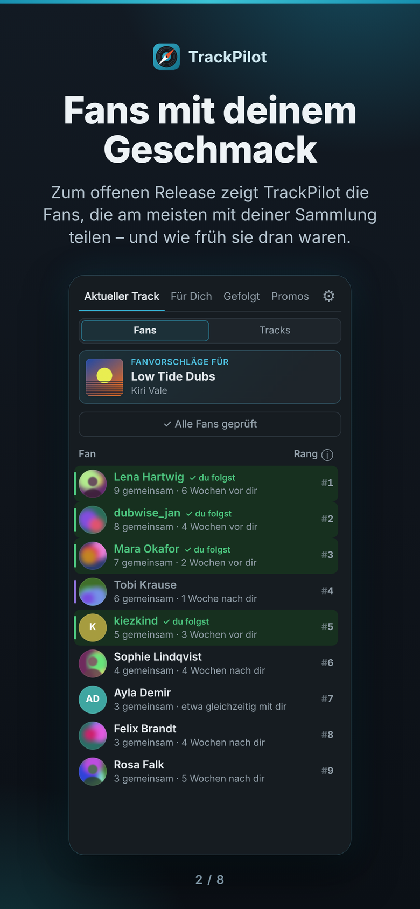
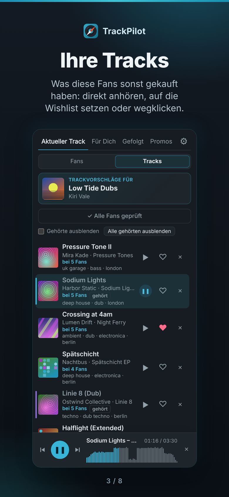
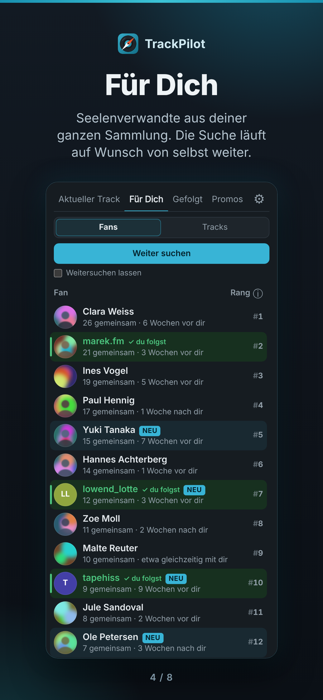
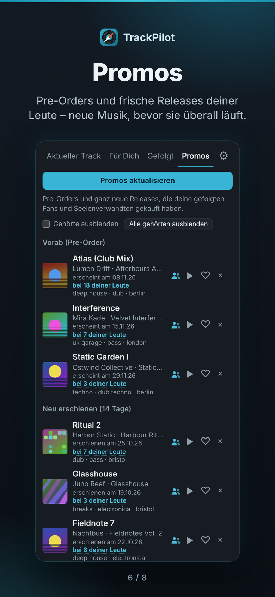

# TrackPilot

**English** · [Deutsch](#deutsch)

TrackPilot is an unofficial side panel for Bandcamp in Chrome and Opera. Open an album or track on Bandcamp and TrackPilot shows you the fans who share the most of your taste – and the music they bought that you don't know yet. It also finds your "soulmates" across your whole collection, collects what the fans you follow are buying, and lists pre-orders and new releases from your people. Everything runs in your browser; there is no server.

  
  
  
  

*(Screenshots show the German interface.)*

## Features

- **Current track** – the fans of the release open on the left, ranked by how many releases they share with you and how early they bought them, plus the tracks they own.
- **For you** – soulmates from your whole collection and the tracks several of them bought.
- **Following** – purchases of the fans you follow on Bandcamp.
- **Promos** – pre-orders and brand-new releases bought by your soulmates and the fans you follow.
- **Player** with waveform: listen right in the panel, ♥ puts a track on your Bandcamp wishlist, ✕ hides it from the suggestions.
- **Player bar on Bandcamp** – a fixed bar at the bottom of Bandcamp pages with waveform and BPM (can be switched off).
- **Genre filter** for all track lists.
- **5 languages** (English, German, French, Spanish, Italian), light and dark mode.

## Install

TrackPilot is not in the Chrome Web Store. You load it as an unpacked extension:

1. On GitHub click **Code → Download ZIP** and unzip the file.
2. Open `chrome://extensions`.
3. Turn on **Developer mode** (top right).
4. Click **Load unpacked** and pick the unzipped folder (the one that contains `manifest.json`).

**Opera:** the same steps on `opera://extensions`. Then pin TrackPilot to the sidebar: at the bottom of the sidebar click **…** → **Sidebar settings** → **Extensions** → **TrackPilot**.

To update, download the new ZIP, replace the folder and click the reload button on the TrackPilot card in `chrome://extensions`. Your data stays.

## Usage

1. Log in to Bandcamp.
2. Click the TrackPilot icon in the toolbar (or press **Alt + T**). The side panel opens; press **Load wishlist** once.
3. Open an album or track on Bandcamp and press **Start search** at the top of the panel.

**Bandcamp rate limit:** Bandcamp only allows a limited number of requests. TrackPilot throttles itself and learns how fast it may go, so searches run slowly on purpose. If Bandcamp pauses it anyway, the search continues on its own.

## Privacy

TrackPilot has no server and no tracking. It reads public pages from Bandcamp and stores everything only in your browser (`chrome.storage.local`). Nothing is sent to the author or to anyone else. To delete all data, use **Settings → Delete everything** or remove the extension. Details: [PRIVACY.md](PRIVACY.md).

## Disclaimer

TrackPilot is an unofficial project. It is not affiliated with, endorsed by or sponsored by Bandcamp. "Bandcamp" is a trademark of its owner.

## License

© 2026 Eric Osterkamp. All rights reserved. The source is published for viewing and personal use of the extension; copying, modifying or redistributing it requires permission. See [LICENSE](LICENSE).

## Feedback

Bugs and ideas are welcome as [GitHub Issues](../../issues). For a bug report, please name your browser, the TrackPilot version and what you did.

Changes: [CHANGELOG.md](CHANGELOG.md)

---

# TrackPilot (Deutsch)

[English](#trackpilot) · **Deutsch**

TrackPilot ist eine inoffizielle Seitenleiste für Bandcamp in Chrome und Opera. Öffne auf Bandcamp ein Album oder einen Track, und TrackPilot zeigt dir die Fans, die am meisten deinen Geschmack teilen – und die Musik aus ihren Käufen, die du noch nicht kennst. Außerdem findet es deine „Seelenverwandten“ über deine ganze Sammlung, sammelt, was die Fans kaufen, denen du folgst, und listet Pre-Orders und neue Releases deiner Leute. Alles läuft in deinem Browser, es gibt keinen Server.

*(Bildschirmfotos siehe oben.)*

## Funktionen

- **Aktueller Track** – die Fans des links offenen Releases, sortiert danach, wie viele Releases sie mit dir teilen und wie früh sie sie gekauft haben, dazu ihre Tracks.
- **Für Dich** – Seelenverwandte aus deiner ganzen Sammlung und die Tracks, die mehrere von ihnen gekauft haben.
- **Gefolgt** – Käufe der Fans, denen du auf Bandcamp folgst.
- **Promos** – Pre-Orders und ganz neue Releases, die deine Seelenverwandten und gefolgten Fans gekauft haben.
- **Player** mit Wellenform: direkt in der Leiste reinhören, ♥ setzt einen Track auf deine Bandcamp-Wishlist, ✕ blendet ihn aus den Vorschlägen aus.
- **Player-Leiste auf Bandcamp** – feste Leiste unten auf Bandcamp-Seiten mit Wellenform und BPM (abschaltbar).
- **Genre-Filter** für alle Tracklisten.
- **5 Sprachen** (Deutsch, Englisch, Französisch, Spanisch, Italienisch), hell und dunkel.

## Installation

TrackPilot steht nicht im Chrome Web Store. Du lädst es als entpackte Erweiterung:

1. Auf GitHub **Code → Download ZIP** klicken und die Datei entpacken.
2. `chrome://extensions` öffnen.
3. Oben rechts den **Entwicklermodus** einschalten.
4. **Entpackte Erweiterung laden** klicken und den entpackten Ordner wählen (den, in dem `manifest.json` liegt).

**Opera:** dieselben Schritte unter `opera://extensions`. Danach TrackPilot in der Seitenleiste anheften: unten in der Seitenleiste auf **…** → **Seitenleisten-Einstellungen** → **Erweiterungen** → **TrackPilot**.

Zum Aktualisieren die neue ZIP laden, den Ordner ersetzen und auf der TrackPilot-Karte in `chrome://extensions` auf „Neu laden“ klicken. Deine Daten bleiben erhalten.

## Benutzung

1. Bei Bandcamp einloggen.
2. Auf das TrackPilot-Symbol in der Symbolleiste klicken (oder **Alt + T**). Die Seitenleiste öffnet sich; einmal **Wishlist laden** drücken.
3. Auf Bandcamp ein Album oder einen Track öffnen und oben in der Leiste **Suche starten** drücken.

**Bandcamp-Limit:** Bandcamp erlaubt nur eine begrenzte Zahl von Anfragen. TrackPilot bremst sich selbst und lernt, wie schnell es sein darf – Suchen laufen darum absichtlich ruhig. Bremst Bandcamp trotzdem, geht die Suche von selbst weiter.

## Datenschutz

TrackPilot hat keinen Server und kein Tracking. Es liest öffentliche Seiten von Bandcamp und speichert alles nur in deinem Browser (`chrome.storage.local`). Nichts wird an den Autor oder sonst jemanden geschickt. Alle Daten löschst du über **Einstellungen → Alles löschen** oder indem du die Erweiterung entfernst. Einzelheiten: [PRIVACY.md](PRIVACY.md#deutsch).

## Hinweis

TrackPilot ist ein inoffizielles Projekt und steht in keiner Verbindung zu Bandcamp, wird von Bandcamp weder unterstützt noch gesponsert. „Bandcamp“ ist eine Marke ihres Inhabers.

## Lizenz

© 2026 Eric Osterkamp. Alle Rechte vorbehalten. Der Quellcode ist zum Ansehen und für die persönliche Nutzung der Erweiterung veröffentlicht; Kopieren, Verändern oder Weitergeben nur mit Erlaubnis. Siehe [LICENSE](LICENSE).

## Feedback

Fehler und Ideen gern als [GitHub Issues](../../issues). Bei Fehlern bitte Browser, TrackPilot-Version und die Schritte dazu angeben.

Änderungen: [CHANGELOG.md](CHANGELOG.md) (englisch)
